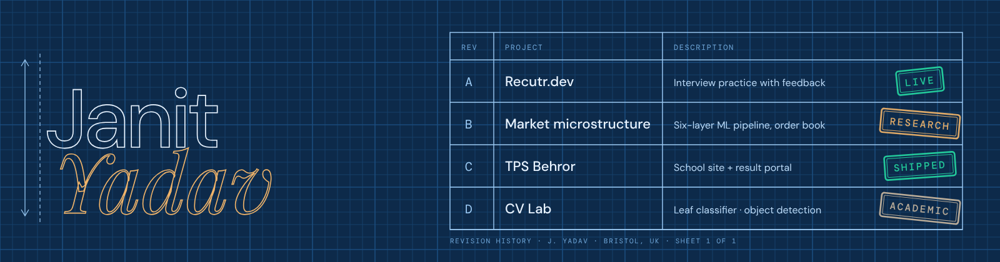

  

**Developer and founder.** MSc FinTech with Data Science at the University of Bristol. I take ideas to shipped products with real users, and I am now applying the same discipline to market microstructure research.

## 1 · General notes

1. Everything under *Detail views* is live, shipped, or labelled as research.
2. Skills are listed only where I have used them in a project.
3. A number appears only if it was measured.
4. Drawn in Bristol, UK. Revised when the work changes.

## 2 · Bill of materials: skills with receipts

| Skill | A · Recutr.dev | B · Microstructure | C · TPS Behror | D · CV Lab |
|:--|:-:|:-:|:-:|:-:|
| **Python** ML, data, Flask services | ○ | ● | ○ | ● |
| **TypeScript · React · Tailwind** front end | ● | ○ | ● | ○ |
| **Node · MongoDB (MERN)** back end and data | ● | ○ | ● | ○ |
| **LightGBM · XGBoost · HMM/GMM** tabular and regime models | ○ | ● | ○ | ○ |
| **PyTorch · ResNet50 · LSTM/TCN** deep learning | ○ | ● | ○ | ● |
| **FinBERT · OpenAI API** language models | ● | ● | ○ | ○ |
| **OpenCV · YOLO** computer vision | ○ | ○ | ○ | ● |
| **Git · Linux · Vercel** shipping and tooling | ● | ● | ● | ● |

## 3 · Detail views

| Rev | Project | What it does | Stack | Status |
|:-:|:--|:--|:--|:-:|
| A | [**Recutr.dev**](https://recutr.dev) | Interview practice that tells you what to fix next. 500+ users, 100+ graded sessions. | `React` `TypeScript` `Node` `MongoDB` | `live` |
| B | [**Market microstructure**](https://janit-portfolio.vercel.app/work/microstructure/) | A six-layer ML pipeline that reads the order book to explain the next few seconds of price, tested walk-forward. | `Python` `LightGBM` `XGBoost` `FinBERT` | `research build` |
| C | [**TPS Behror**](https://tpsbehror.co.in) | Production school website with a student result portal and an admin panel. | `MERN` | `shipped` |
| D | [**CV Lab**](https://janit-portfolio.vercel.app/work/) | Plant-disease classifier on ResNet50 (including an architecture-mismatch bug I found and fixed) and real-time object detection. | `PyTorch` `OpenCV` `YOLO` | `academic` |

## 4 · Section: route

## 5 · Open items

Learning next: `LangChain` · `Next.js` · `Vector databases`

## 6 · References

*Designing ML Systems* (Chip Huyen) · *The Pragmatic Programmer* (Hunt and Thomas) · *Attention Is All You Need* (Vaswani et al.)

## 7 · Contact

[Portfolio](https://janit-portfolio.vercel.app) · [Email](mailto:janityadav16@gmail.com) · [LinkedIn](https://linkedin.com/in/janit-yadav-461140279) · [GitHub](https://github.com/janityadav16)
<!-- add once the PDF exists: · [CV (PDF)](...) -->

  

