  

> **Developer and founder.** MSc FinTech with Data Science at the University of Bristol. I take ideas to shipped products with real users, and I am now applying the same discipline to market microstructure research.

1. Everything listed here is live, shipped, or labelled as research.
2. Skills are listed only where I have used them in a project.
3. A number appears only if it was measured.
4. Drawn in Bristol, UK. Revised when the work changes.

| Skill | A · Recutr.dev | B · Microstructure | C · TPS Behror | D · CV Lab |
|:--|:-:|:-:|:-:|:-:|
| **Python** ML, data, Flask services | ○ | ● | ○ | ● |
| **TypeScript · React · Tailwind** front end | ● | ○ | ● | ○ |
| **Node · MongoDB (MERN)** back end and data | ● | ○ | ● | ○ |
| **LightGBM · XGBoost · HMM/GMM** tabular and regime models | ○ | ● | ○ | ○ |
| **PyTorch · ResNet50 · LSTM/TCN** deep learning | ○ | ● | ○ | ● |
| **FinBERT · OpenAI API** language models | ● | ● | ○ | ○ |
| **OpenCV · YOLO** computer vision | ○ | ○ | ○ | ● |
| **Git · Linux · Vercel** shipping and tooling | ● | ● | ● | ● |

*Designing ML Systems* (Chip Huyen) · *The Pragmatic Programmer* (Hunt and Thomas) · *Attention Is All You Need* (Vaswani et al.)

[Portfolio](https://janit-portfolio.vercel.app) · [Email](mailto:janityadav16@gmail.com) · [LinkedIn](https://linkedin.com/in/janit-yadav-461140279) · [GitHub](https://github.com/janityadav16)
<!-- add once the PDF exists: · [CV (PDF)](...) -->

  

